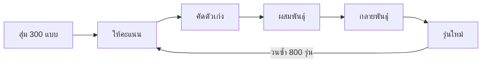

# HR GA Team Balancer

> แบ่งพนักงานเป็น 2 กลุ่ม (แดง / น้ำเงิน) ด้วย **Genetic Algorithm** ให้ยุติธรรม และได้รู้จักคนข้ามแผนก

**สารบัญ:** [รายละเอียดโปรเจค](#รายละเอียดโปรเจค) · [วิธีรัน](#วิธีรัน) · [ไฟล์ในโปรเจค](#ไฟล์ในโปรเจค) · [หลักการทำงาน](#หลักการทำงาน) · [ผลลัพธ์](#ผลลัพธ์) · [ข้อจำกัด](#ข้อจำกัด) · [การปรับแต่ง](#การปรับแต่ง)

---

## รายละเอียดโปรเจค

แบ่งพนักงาน **358 คน** จาก **19 แผนก** ออกเป็น 2 กลุ่มเท่า ๆ กัน โดยมีเป้าหมาย 2 ข้อ

| เป้าหมาย | ความหมาย |
|---|---|
| **Fairness** (ความยุติธรรม) | สองกลุ่มมีคนเท่ากัน ชาย/หญิงเท่ากัน อายุ น้ำหนัก ส่วนสูงเฉลี่ยใกล้กัน |
| **Harmonise** (รู้จักข้ามแผนก) | ทุกแผนกถูกแบ่งครึ่งไปอยู่ทั้งสองสี ทุกกลุ่มมีคนจากหลายแผนกปนกัน |

**ผลโดยสรุป**

- กลุ่มละ 179 คน
- ชาย/หญิงเท่ากันพอดี (61 / 118)
- ค่าเฉลี่ยอายุ น้ำหนัก ส่วนสูง ต่างกันไม่ถึง 0.2
- แผนกส่วนใหญ่ถูกแบ่งครึ่งพอดี

---

## วิธีรัน

**1. ติดตั้ง** (ต้องมี Python 3)

```bash
pip install numpy
```

**2. รัน UI หากต้องการเห็นภาพ**

```bash
python ga_grouping.py
```
```
Ui.py
```

**3. ดูผล** ในไฟล์ `HR_groups.csv`

> ใช้ random seed คงที่ (`42`) รันกี่ครั้งก็ได้ผลเหมือนเดิม และรันจากโฟลเดอร์ไหนก็ได้

---

## ไฟล์ในโปรเจค

```
HR/
├── Data_sheet/
│   └── HR(in).csv
├── ga_grouping.py
├── HR_groups.csv
└── README.md
```

| ไฟล์ | หน้าที่ |
|---|---|
| `Data_sheet/HR(in).csv` | ข้อมูลนำเข้า: พนักงาน 358 คน คอลัมน์ `gender, department, weight, height, age` |
| `ga_grouping.py` | โค้ด Genetic Algorithm |
| `HR_groups.csv` | ผลลัพธ์: ข้อมูลเดิม + คอลัมน์ `group` (`Red` / `Blue`) ถูกเขียนทับทุกครั้งที่รัน |
| `README.md` | คำอธิบายโปรเจค |

---

## หลักการทำงาน

GA เลียนแบบการคัดเลือกตามธรรมชาติ ให้วิธีแบ่งกลุ่มที่ดีอยู่รอดและพัฒนาต่อไปเรื่อย ๆ



| ขั้น | ทำอะไร | รายละเอียดทางเทคนิค |
|---|---|---|
| 1. สุ่มคำตอบ | สุ่มวิธีแบ่งกลุ่ม 300 แบบ | โครโมโซม = เลข 0/1 ยาว 358 ตัว (0 = แดง, 1 = น้ำเงิน) มีเลข 1 ครึ่งหนึ่งพอดีเสมอ |
| 2. ให้คะแนน | ดูว่าแต่ละแบบไม่สมดุลแค่ไหน | Fitness / cost (ดูด้านล่าง) |
| 3. คัดตัวเก่ง | เลือกแบบที่ดีมาเป็นพ่อแม่ | Tournament selection: สุ่ม 4 แบบ เลือกแบบที่ดีที่สุด |
| 4. ผสมพันธุ์ | รวมสองแบบเป็นแบบใหม่ | Uniform crossover แล้วซ่อมให้สองกลุ่มมีขนาดเท่ากัน |
| 5. กลายพันธุ์ | สลับคนแดงกับน้ำเงิน | สลับ 1 ถึง 3 คู่ |
| 6. รุ่นใหม่ | เก็บของดีไว้เสมอ | Elitism: 6 แบบที่ดีที่สุดผ่านไปรุ่นถัดไป |

### คะแนน (cost) — ยิ่งต่ำยิ่งดี, 0 = สมดุลสมบูรณ์

```
cost = 3 × แผนก + 2 × เพศ + 1 × ค่าเฉลี่ย
```

| ส่วน | วัดอะไร |
|---|---|
| **แผนก** | แต่ละแผนกห่างจากการแบ่งครึ่งต่อครึ่งแค่ไหน (แผนกที่มีคนเป็นเลขคี่ ต่างกัน 1 คนได้ไม่ถูกหักคะแนน) |
| **เพศ** | จำนวนผู้ชายในสองกลุ่มต่างกันเท่าไร |
| **ค่าเฉลี่ย** | อายุ น้ำหนัก ส่วนสูงเฉลี่ยต่างกันเท่าไร (หารด้วยส่วนเบี่ยงเบนมาตรฐานก่อน ให้ทั้งสามมีน้ำหนักเท่ากัน) |

---

## ผลลัพธ์

ใช้ seed = 42 คะแนนลดจาก **0.41** (สุ่ม) เหลือ **0.0513**

| กลุ่ม | จำนวน | ชาย / หญิง | อายุเฉลี่ย | น้ำหนักเฉลี่ย | ส่วนสูงเฉลี่ย |
|---|:-:|:-:|:-:|:-:|:-:|
| Red | 179 | 61 / 118 | 41.2 | 72.0 | 167.9 |
| Blue | 179 | 61 / 118 | 41.3 | 72.2 | 167.9 |

**การแบ่งแผนก**

| ผล | จำนวนแผนก | แผนก |
|---|:-:|---|
| ครึ่งพอดี | 12 | A, C, D, E, F, G, H, L, M, N, P, S |
| ต่าง 1 คน (คนเป็นเลขคี่) | 6 | B, I, J, K, Q, R |
| ต่าง 2 คน | 1 | O |

<details>
<summary>ดูจำนวนคนทุกแผนก</summary>

| แผนก | ทั้งหมด | แดง | น้ำเงิน |
|:-:|:-:|:-:|:-:|
| A | 6 | 3 | 3 |
| B | 1 | 1 | 0 |
| C | 6 | 3 | 3 |
| D | 72 | 36 | 36 |
| E | 14 | 7 | 7 |
| F | 28 | 14 | 14 |
| G | 40 | 20 | 20 |
| H | 10 | 5 | 5 |
| I | 7 | 3 | 4 |
| J | 29 | 15 | 14 |
| K | 19 | 10 | 9 |
| L | 10 | 5 | 5 |
| M | 14 | 7 | 7 |
| N | 8 | 4 | 4 |
| O | 32 | 15 | 17 |
| P | 22 | 11 | 11 |
| Q | 5 | 2 | 3 |
| R | 23 | 12 | 11 |
| S | 12 | 6 | 6 |

</details>

---

## ข้อจำกัด

- **แผนก B** มีพนักงานคนเดียว จึงอยู่ได้แค่สีเดียว (แดง)
- **แผนกที่มีคนเป็นเลขคี่** (I, J, K, Q, R) สองสีจะต่างกัน 1 คนเสมอ
- **แผนก O** แบ่งเป็น 15/17 ยังไม่ครึ่งพอดี เพราะ GA เลือกแลกกับความสมดุลด้านอื่น

---

## การปรับแต่ง

แก้ได้ใน `ga_grouping.py`

| ต้องการ | แก้ที่ |
|---|---|
| ย้าย/เปลี่ยนชื่อไฟล์ข้อมูล | `INPUT = ...` |
| ให้ GA ค้นหานานขึ้น (เช่น แก้แผนก O) | `GENERATIONS` |
| เปลี่ยนจำนวนประชากร / elitism | `POP_SIZE`, `ELITE` |
| เน้นเป้าหมายไหนมากขึ้น | ตัวคูณ `3` (แผนก) และ `2` (เพศ) ในฟังก์ชัน `cost()` |
